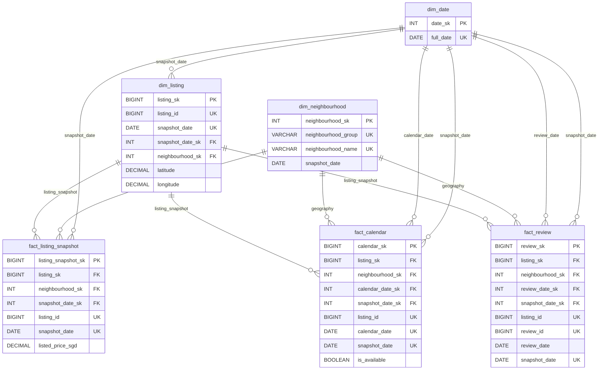

# Warehouse ERD – Task 3.5

## Grain đã duyệt

| Bảng | Grain (một dòng đại diện) | Khóa nghiệp vụ duy nhất |
|---|---|---|
| `dim_date` | Một ngày lịch | `full_date` |
| `dim_neighbourhood` | Một khu vực quy hoạch thuộc một vùng | `(neighbourhood_group, neighbourhood_name)` |
| `dim_listing` | Một tin đăng ở một snapshot | `(listing_id, snapshot_date)` |
| `fact_listing_snapshot` | Một tin đăng ở một snapshot | `(listing_id, snapshot_date)` |
| `fact_calendar` | Một tin đăng ở một ngày lịch trong một snapshot | `(listing_id, calendar_date, snapshot_date)` |
| `fact_review` | Một review của một listing trong một snapshot | `(listing_id, review_id, snapshot_date)` |

## Sơ đồ quan hệ

Các Fact tham chiếu `dim_listing` bằng bộ `(listing_sk, snapshot_date_sk, neighbourhood_sk)`. Khóa ngoại ghép này ngăn Fact gắn listing với snapshot hoặc khu vực khác. Mỗi Fact giữ UNIQUE theo đúng business grain để chặn nạp trùng cùng snapshot. `fact_calendar` và `fact_review` là các grain chi tiết riêng; không nối trực tiếp hai bảng này rồi cộng số listing. KPI cấp listing phải lấy từ `fact_listing_snapshot` hoặc tổng hợp từng Fact về grain đích trước khi kết hợp.

DDL vật lý: [`sql/02_warehouse_schema.sql`](../sql/02_warehouse_schema.sql). Bảng ánh xạ nguồn–đích: [`source_to_target_mapping.csv`](source_to_target_mapping.csv).
