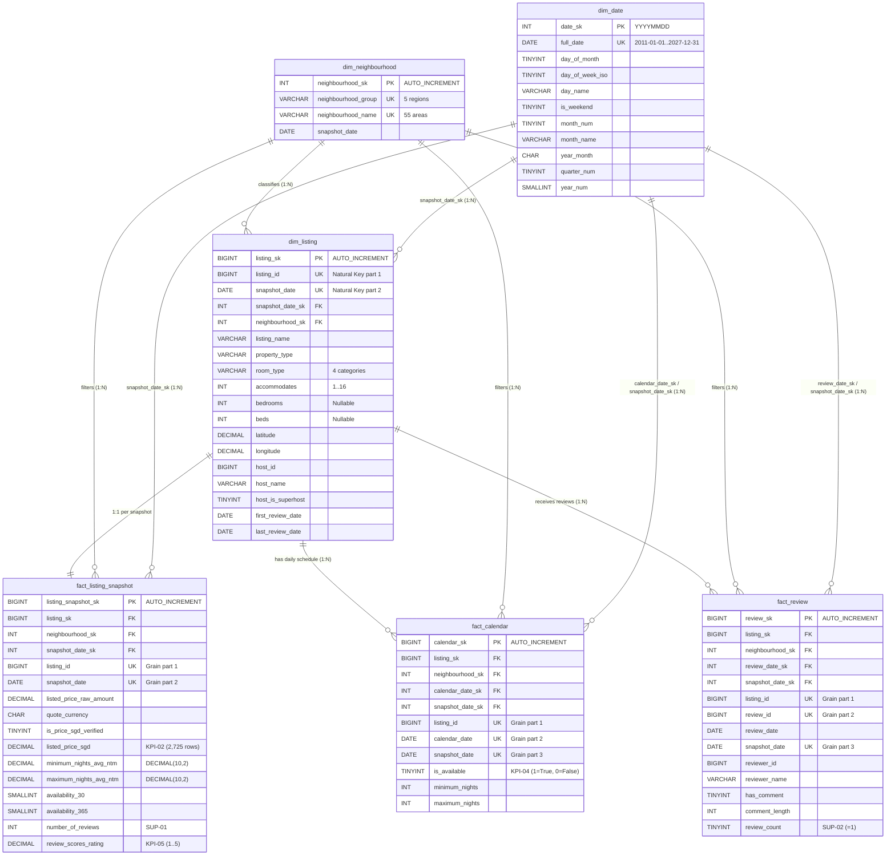

# Thiết kế Grain, Dimension, Fact và Bản nháp Schema Kho Dữ liệu (Task 2.5)

- **Mã công việc:** WBS 2.5 – Xác định grain, Dimension và Fact
- **Phụ trách chính:** Minh (Data Warehouse / MySQL / SQL KPI)
- **Phối hợp xác nhận:** Hồng (Data Dictionary / EDA) & Thái (ETL / Mapping)
- **Định hướng mô hình:** Kimball Dimensional Modeling – **Fact Constellation (Galaxy Schema)**
- **Tệp bàn giao đi kèm:**
  - Danh mục chi tiết 128 cột của 6 bảng Warehouse: [`docs/warehouse_schema_columns.csv`](warehouse_schema_columns.csv)
  - Bản nháp DDL MySQL 8.0: [`sql/02_warehouse_schema_draft.sql`](../sql/02_warehouse_schema_draft.sql)
  - Kết quả kiểm chứng độ tương thích nguồn $\rightarrow$ đích: [`tests/task_2_4_2_5_verification.csv`](../tests/task_2_4_2_5_verification.csv)

---

## 1. Quy trình thiết kế 4 bước theo phương pháp Kimball

Để giải quyết bài toán tích hợp 4 nguồn dữ liệu Inside Airbnb có độ chi tiết (grain) khác nhau mà không gây nhân bản dữ liệu (JOIN fan-out), kho dữ liệu được thiết kế tuân thủ chặt chẽ 4 bước của Kimball:

### Bước 1: Lựa chọn quy trình nghiệp vụ (Business Processes)
Dựa trên 5 câu hỏi nghiên cứu (`RQ1`–`RQ5`) và 7 chỉ tiêu phân tích (`KPI-01`–`KPI-05`, `SUP-01`, `SUP-02`), hệ thống mô hình hóa **3 quy trình nghiệp vụ**:
1. **Quy trình 1 – Chụp trạng thái tin đăng định kỳ (`Listing Snapshot Process`):** Ghi nhận quy mô nguồn cung, giá niêm yết mỗi đêm, cấu hình lưu trú và điểm/số lượng đánh giá tích lũy của từng tin đăng tại thời điểm snapshot.
2. **Quy trình 2 – Theo dõi trạng thái lịch theo ngày (`Daily Calendar Availability Process`):** Ghi nhận trạng thái mở/đóng lịch (`available`) và yêu cầu số đêm tối thiểu/tối đa của từng tin đăng trên từng ngày lịch trong cửa sổ 365–366 ngày tiếp theo.
3. **Quy trình 3 – Ghi nhận sự kiện đánh giá của khách hàng (`Customer Review Event Process`):** Ghi nhận từng lượt đánh giá lịch sử gắn với tin đăng và ngày đăng đánh giá để phân tích lưu lượng đánh giá theo thời gian.

### Bước 2: Tuyên bố độ chi tiết (Grain Declaration)

| Bảng Fact | Loại bảng Fact (Kimball) | Tuyên bố Grain chính xác | Khóa tự nhiên (Natural / Business Key) | Số dòng (Snapshot `2026-09-23`) |
|---|---|---|---|---:|
| **`fact_listing_snapshot`** | Periodic Snapshot Fact | **1 dòng = 1 tin đăng (`listing`) tại 1 kỳ snapshot (`snapshot_date`)** | `(listing_id, snapshot_date)` | `3,208` |
| **`fact_calendar`** | Periodic Daily Grain Snapshot Fact | **1 dòng = 1 tin đăng (`listing`) tại 1 ngày lịch (`calendar_date`) trong 1 kỳ snapshot (`snapshot_date`)** | `(listing_id, calendar_date, snapshot_date)` | `1,170,950` |
| **`fact_review`** | Transaction / Event Fact (Factless Count) | **1 dòng = 1 bản ghi đánh giá xác định bởi cặp `(listing_id, review_id)` thu thập tại 1 kỳ snapshot (`snapshot_date`)** | `(listing_id, review_id, snapshot_date)` | `46,000` |

> [!IMPORTANT]
> **Vì sao Grain của `fact_review` dùng khóa ghép `(listing_id, review_id, snapshot_date)`?**
> Kết quả khảo sát thực nghiệm (Task 2.2 & 2.3) trên `reviews.csv.gz` (`46,000` dòng) cho thấy cột `id` (`review_id`) đơn lẻ chỉ có `41,191` giá trị phân biệt (có `4,809` dòng dư theo `id` riêng lẻ; `2,101` mã review xuất hiện ở nhiều listing, liên quan `197` listing; quan sát các mã này cùng host chưa chứng minh nguyên nhân nghiệp vụ), nhưng cặp **`(listing_id, id)` đạt độ duy nhất 100% (`46,000/46,000` dòng, `0` dòng trùng)**. Việc bổ sung `snapshot_date` giúp mô hình sẵn sàng mở rộng nhiều snapshot mà không xung đột khóa.

### Bước 3: Xác định các bảng chiều dùng chung (Conformed Dimensions)
Nhóm thiết kế **3 bảng Dimension chuẩn hóa (Conformed Dimensions)** dùng chung cho cả 3 bảng Fact, tạo thành cấu trúc **Fact Constellation**:
1. **`dim_date`:** Một bảng thời gian vật lý trong warehouse (các vai trò tách rõ trong Power BI ở mục 5.4) cho ngày snapshot (`snapshot_date_sk`), ngày lịch (`calendar_date_sk`) và ngày đánh giá (`review_date_sk`). Bao phủ liên tục từ `2011-01-01` đến `2027-12-31` (`6,209` ngày).
2. **`dim_neighbourhood`:** Chiều phân cấp địa lý tại Singapore (`neighbourhood_group` $\rightarrow$ `neighbourhood_name`), gồm `55` khu vực quy hoạch chuẩn từ `neighbourhoods.csv`.
3. **`dim_listing`:** Chiều mô tả đặc điểm tin đăng (`room_type`, `property_type`, `accommodates`, `bedrooms`, `beds`, `latitude`, `longitude`, ...) **kết hợp (denormalized) các thuộc tính mô tả của chủ nhà (`host_id`, `host_name`, `host_is_superhost`, ...)**.
   - *Lý do không tách bảng `dim_host` riêng:* Các câu hỏi nghiên cứu `RQ1`–`RQ4` và 7 chỉ tiêu KPI đều phân tích ở cấp `listing`, `room_type` và `neighbourhood`. Gộp các thuộc tính mô tả `host_*` vào `dim_listing` giảm số bảng tra cứu host; sơ đồ warehouse và mô hình lọc Power BI phải được cấu hình riêng theo mục 5.4 và khớp hoàn toàn với Mục 6.2 của `docs/project_scope.md` cũng như yêu cầu của Task 3.5.

### Bước 4: Phân loại Facts (Thước đo định lượng) vs. Thuộc tính mô tả (Descriptive Attributes)

| Tiêu chí phân loại | Đặt tại `dim_listing` / `dim_neighbourhood` / `dim_date` | Đặt tại `fact_listing_snapshot` / `fact_calendar` / `fact_review` |
|---|---|---|
| **Bản chất dữ liệu** | Chuỗi văn bản mô tả, phân loại danh mục, cờ trạng thái tĩnh, tọa độ định vị, tên/mã chủ nhà. | Các đại lượng số học dùng để đếm, tính tổng (`SUM`), trung bình (`AVG`), trung vị (`MEDIAN`), tỷ lệ (`%`). |
| **Vai trò trong truy vấn BI** | Dùng trong mệnh đề `GROUP BY`, `WHERE`, Slicer/Filter và trục phân nhóm trên biểu đồ Power BI. | Dùng trong hàm tổng hợp của mệnh đề `SELECT` và giá trị hiển thị trên KPI Card / trục đo lường. |
| **Các trường đại diện** | `room_type`, `property_type`, `neighbourhood_group`, `neighbourhood_name`, `accommodates`, `bedrooms`, `beds`, `bathrooms_text`, `latitude`, `longitude`, `host_id`, `host_name`, `host_is_superhost`, `license`, `first_review_date`, `last_review_date`. | `listed_price_sgd`, `listed_price_raw_amount`, `price_quote_price_per_night`, `minimum_nights`, `maximum_nights`, `minimum_nights_avg_ntm`, `maximum_nights_avg_ntm`, `availability_30/60/90/365/eoy`, `number_of_reviews`, `review_scores_rating` (và 6 điểm thành phần), `is_available`, `review_count`. |

---

## 2. Ma trận Bus (Kimball Enterprise Bus Matrix)

| Quy trình nghiệp vụ | Bảng Fact | Grain | `dim_date` | `dim_neighbourhood` | `dim_listing` | Câu hỏi nghiên cứu & KPI phục vụ trực tiếp |
|---|---|---|:---:|:---:|:---:|---|
| **1. Chụp trạng thái tin đăng** | `fact_listing_snapshot` | 1 listing / 1 snapshot | $\checkmark$ (`snapshot_date_sk`) | $\checkmark$ (`neighbourhood_sk`) | $\checkmark$ (`listing_sk`) | **RQ1, RQ2, RQ4** — `KPI-01` (Total Listings), `KPI-02` (Median Price SGD), `KPI-03` (Room Type Share), `KPI-05` (Avg Review Score), `SUP-01` (Median Review Count) |
| **2. Mở/đóng lịch theo ngày** | `fact_calendar` | 1 listing / 1 ngày lịch / 1 snapshot | $\checkmark$ (`calendar_date_sk`, `snapshot_date_sk`) | $\checkmark$ (`neighbourhood_sk`) | $\checkmark$ (`listing_sk`) | **RQ3** — `KPI-04` (Available Night Ratio trên cùng cửa sổ ngày `2026-09-25`..`2027-09-25`) |
| **3. Sự kiện đánh giá** | `fact_review` | 1 bản ghi review `(listing_id, review_id)` / 1 snapshot | $\checkmark$ (`review_date_sk`, `snapshot_date_sk`) | $\checkmark$ (`neighbourhood_sk`) | $\checkmark$ (`listing_sk`) | **RQ4** — `SUP-02` (Review Records in Period phân tích theo kỳ/khu vực/loại phòng) |

---

## 3. Sơ đồ Quan hệ Thực thể (Fact Constellation ERD)

---

## 4. Đặc tả Khóa (PK, SK, FK, Unique BK) và Quan hệ `1-n`

| Tên bảng | Surrogate Primary Key (`PK`) | Business / Natural Key (`UNIQUE`) | Foreign Keys (`FK`) & Quan hệ `n-1` |
|---|---|---|---|
| **`dim_date`** | `date_sk` (`INT`, `YYYYMMDD`) | `uq_dim_date_full_date (full_date)` | Bảng cha của mọi mốc thời gian (`1:N` tới các bảng Fact và `dim_listing`). |
| **`dim_neighbourhood`** | `neighbourhood_sk` (`INT UNSIGNED AUTO_INCREMENT`) | `uq_dim_neighbourhood_bk (neighbourhood_group, neighbourhood_name)` | Bảng cha phân loại địa lý (`1:N` tới `dim_listing` và 3 bảng Fact). |
| **`dim_listing`** | `listing_sk` (`BIGINT UNSIGNED AUTO_INCREMENT`) | `uq_dim_listing_bk (listing_id, snapshot_date)` | - `snapshot_date_sk` $\rightarrow$ `dim_date(date_sk)` - `neighbourhood_sk` $\rightarrow$ `dim_neighbourhood(neighbourhood_sk)` |
| **`fact_listing_snapshot`** | `listing_snapshot_sk` (`BIGINT UNSIGNED AUTO_INCREMENT`) | `uq_fact_listing_snapshot_grain (listing_id, snapshot_date)` `uq_fact_listing_sk_snap (listing_sk, snapshot_date_sk)` | - `listing_sk` $\rightarrow$ `dim_listing(listing_sk)` - `neighbourhood_sk` $\rightarrow$ `dim_neighbourhood(neighbourhood_sk)` - `snapshot_date_sk` $\rightarrow$ `dim_date(date_sk)` |
| **`fact_calendar`** | `calendar_sk` (`BIGINT UNSIGNED AUTO_INCREMENT`) | `uq_fact_calendar_grain (listing_id, calendar_date, snapshot_date)` | - `listing_sk` $\rightarrow$ `dim_listing(listing_sk)` (`N:1`, ~365 dòng lịch / 1 listing) - `neighbourhood_sk` $\rightarrow$ `dim_neighbourhood(neighbourhood_sk)` - `calendar_date_sk` $\rightarrow$ `dim_date(date_sk)` - `snapshot_date_sk` $\rightarrow$ `dim_date(date_sk)` |
| **`fact_review`** | `review_sk` (`BIGINT UNSIGNED AUTO_INCREMENT`) | `uq_fact_review_grain (listing_id, review_id, snapshot_date)` | - `listing_sk` $\rightarrow$ `dim_listing(listing_sk)` (`N:1`, trung bình ~25 review / listing có review) - `neighbourhood_sk` $\rightarrow$ `dim_neighbourhood(neighbourhood_sk)` - `review_date_sk` $\rightarrow$ `dim_date(date_sk)` - `snapshot_date_sk` $\rightarrow$ `dim_date(date_sk)` |

*Danh sách đầy đủ 128 cột của 6 bảng kèm kiểu dữ liệu và mô tả chi tiết được lưu tại [`docs/warehouse_schema_columns.csv`](warehouse_schema_columns.csv) và định nghĩa DDL tại [`sql/02_warehouse_schema_draft.sql`](../sql/02_warehouse_schema_draft.sql).*

---

## 5. Chiến lược Snapshot và Quy tắc Chống Nhân bản Số liệu (Anti-Fanout Strategy)

### 5.1. Nguy cơ nhân bản số dòng (JOIN Fan-out / Chasm Trap) đã chứng minh trong EDA
- Trong snapshot `2026-09-23`:
  - `fact_listing_snapshot` có `3,208` dòng (1 dòng / listing).
  - `fact_calendar` có `1,170,950` dòng (~365 dòng / listing).
  - `fact_review` có `46,000` dòng (trải trên `1,839` listing).
- Nếu thực hiện truy vấn SQL hoặc tạo quan hệ trong Power BI bằng cách nối trực tiếp `fact_calendar` với `fact_review` theo `listing_id`, tích Đề-các trên từng listing sẽ làm phình số dòng lên tới **`16,791,449` dòng** (theo `tests/data_quality_baseline.csv`), khiến:
  - Số lượng listing bị nhân gấp hàng trăm lần.
  - Trung vị giá niêm yết (`KPI-02`) bị lệch về các listing có nhiều review.
  - Tỷ lệ mở lịch (`KPI-04`) và số lượng review (`SUP-02`) bị sai hoàn toàn.

### 5.2. Ba quy tắc bắt buộc khi truy vấn SQL và thiết lập Model Power BI
1. **Quy tắc 1 – Mỗi KPI chỉ tính trên đúng bảng Fact có cùng Grain:**
   - `KPI-01` (Total Listings), `KPI-02` (Median Listed Price SGD), `KPI-03` (Room Type Share), `KPI-05` (Average Review Score) và `SUP-01` (Median Review Count per Listing) **chỉ truy vấn từ `fact_listing_snapshot`** (kết hợp `dim_listing`, `dim_neighbourhood`, `dim_date`).
   - `KPI-04` (Available Night Ratio) **chỉ truy vấn từ `fact_calendar`** (kết hợp `dim_listing`, `dim_neighbourhood`, `dim_date`).
   - `SUP-02` (Review Records in Period) **chỉ truy vấn từ `fact_review`** (kết hợp `dim_listing`, `dim_neighbourhood`, `dim_date`).
2. **Quy tắc 2 – Khi cần kết hợp chỉ số từ nhiều Fact trên cùng báo cáo (Drill-across):**
   - Trong **SQL**: Bắt buộc **tổng hợp (GROUP BY `listing_sk` hoặc `neighbourhood_sk`, `room_type`) từng bảng Fact trong CTE riêng biệt** để đưa về cùng một grain đích trước khi `JOIN` các CTE lại với nhau. Tuyệt đối cấm `FROM fact_calendar JOIN fact_review ON ...` ở mức dòng chi tiết.
   - Trong **Power BI**: Không tự động bật tất cả FK của ERD thành quan hệ active. Dùng bảng quan hệ ở mục 5.4; không nối fact với fact và không tạo nhiều đường lọc active tới cùng fact.
3. **Quy tắc 3 – Quản lý đa Snapshot:**
   - Mọi bảng Fact và `dim_listing` đều chứa `snapshot_date` và `snapshot_date_sk`.
   - Khi nạp lại cùng một snapshot (`2026-09-23`), sử dụng cơ chế `INSERT ... ON DUPLICATE KEY UPDATE` (hoặc xóa phân vùng `WHERE snapshot_date = '2026-09-23'` trước khi nạp) dựa trên `UNIQUE KEY` của grain để đảm bảo chạy lại nhiều lần không sinh dòng trùng (`TQ-05`).
   - Khi mở rộng thêm snapshot thứ hai (ví dụ `2026-06-29`), mọi truy vấn KPI mặc định phải có bộ lọc `WHERE snapshot_date = <selected_snapshot>` để không cộng gộp hai kỳ chụp vào nhau.

---

### 5.4. Mô hình semantic Power BI: quan hệ active tách khỏi FK vật lý

Một bảng `dim_date` trong MySQL vẫn phù hợp cho SQL với các vai trò ngày riêng.
Trong Power BI, tạo ba query tham chiếu từ nó: `dim_snapshot_date`,
`dim_calendar_date`, `dim_review_date`. Không import rồi bật tất cả FK trong ERD.

| Bảng chiều / khóa phía 1 | Cột đích phía nhiều | Trạng thái và chiều lọc |
|---|---|---|
| `dim_listing.listing_sk` | `listing_sk` của cả 3 fact | Active, Single 1 -> * |
| `dim_neighbourhood.neighbourhood_sk` | `neighbourhood_sk` của cả 3 fact | Active, Single 1 -> * |
| `dim_snapshot_date.date_sk` | `snapshot_date_sk` của cả 3 fact | Active, Single 1 -> * |
| `dim_calendar_date.date_sk` | `fact_calendar.calendar_date_sk` | Active, Single 1 -> * |
| `dim_review_date.date_sk` | `fact_review.review_date_sk` | Active, Single 1 -> * |
| `dim_neighbourhood` -> `dim_listing` | FK vật lý warehouse | Không tạo quan hệ lọc trong Power BI |
| `dim_snapshot_date` -> `dim_listing` | FK vật lý warehouse | Không tạo quan hệ lọc trong Power BI |
| Fact -> Fact | Bất kỳ khóa nào | Không tạo |

Như vậy mỗi chiều chỉ có một đường lọc active tới mỗi fact. `dim_listing`
được lọc qua measure dựa trên fact; tắt Show items with no data khi cần ẩn
listing ngoài snapshot chọn. Không thêm quan hệ ngược để làm slicer cascade.
Nếu cần slicer listing tự thu hẹp theo snapshot/khu vực, dùng measure lọc
visual hoặc query dimension phù hợp; không bật đường lọc kép qua dim_listing.
Các dimension có thể giữ cột FK nguồn để audit nhưng ẩn khỏi trường BI khi cần.

Slicer snapshot phải single-select, bắt buộc chọn một snapshot. Ngày Calendar
chỉ lọc fact_calendar; ngày Reviews chỉ lọc fact_review. Không dùng một slicer
ngày chung để đồng thời lọc snapshot 2026-09-23 và lịch 2026-09-25..2027-09-25.
Các measure listing/KPI-03 lấy số liệu từ fact_listing_snapshot, không đếm toàn
bộ dim_listing đa snapshot. Dùng cột khu vực từ dim_neighbourhood để nhóm địa lý.

Phương án dùng một dim_date với quan hệ inactive/USERELATIONSHIP cũng có thể
thiết kế, nhưng không trộn với phương án active ở bảng trên. Đây là đặc tả
cấu hình dự kiến; chưa xác nhận trên file PBIX thực tế.
Tham khảo: [Microsoft — Model relationships](https://learn.microsoft.com/en-us/power-bi/transform-model/desktop-relationships-understand)
và [Role-playing dimensions](https://learn.microsoft.com/en-us/power-bi/guidance/star-schema#role-playing-dimensions).

---

## 6. Xác nhận Độ tương thích Trường Dữ liệu Nguồn cùng Hồng và Thái

Script [`scripts/task_2_4_2_5_mapping_and_schema.py`](../scripts/task_2_4_2_5_mapping_and_schema.py) kiểm tra 4 file raw và tính nhất quán thiết kế tĩnh. Kết quả lần chạy hiện tại gồm **15 kiểm tra**, lưu tại [`tests/task_2_4_2_5_verification.csv`](../tests/task_2_4_2_5_verification.csv). Các kết quả PASS này **không khẳng định đã chạy DDL, nạp Gold hay đối chiếu MySQL**; xem [`gold_reconciliation.md`](gold_reconciliation.md).

| Mã kiểm chứng | Hạng mục xác nhận | Kết quả thực nghiệm trên dữ liệu nguồn | Trạng thái |
|---|---|---|---|
| `V-01` & `V-02` | Độ phủ và tên cột nguồn | Khớp chính xác **103/103 cột** (`90` Listings, `5` Calendar, `6` Reviews, `2` Neighbourhoods). | **PASS** |
| `V-03` .. `V-06` | Tính duy nhất của khóa Grain | `0` dòng trùng trên `Listings(id, snapshot_date)`, `Calendar(listing_id, date, snapshot_date)`, `Reviews(listing_id, id, snapshot_date)` và `Neighbourhoods(neighbourhood_group, neighbourhood)`. | **PASS** |
| `V-07` .. `V-09` | Toàn vẹn khóa ngoại (`FK`) | `100%` `listing_id` của Calendar (`1,170,950`) và Reviews (`46,000`) tồn tại trong Listings (`3,208`); `42/42` cặp khu vực của Listings tồn tại trong `55` dòng của Neighbourhoods (`0` orphan). | **PASS** |
| `V-10` | Đáp ứng quy tắc `KPI-02` (Giá & SGD) | Tách chính xác `2,728` dòng có giá số và **`2,725` dòng xác nhận `quote.currency = 'SGD'`** (`Median = 202.83 SGD/đêm`). | **PASS** |
| `V-11` | Baseline raw của 7 chỉ tiêu KPI & SUP (so sánh thật) | `KPI-01 = 3,208`; `KPI-02 = 202.83 SGD`; `KPI-03` đủ 4 loại phòng (`Private room: 1,827`, `Entire home/apt: 1,232`, `Hotel room: 83`, `Shared room: 66`); `KPI-04 = 76.9427%`; `KPI-05 = 4.5394` (`1,839` listing); `SUP-01 = 1.0`; `SUP-02 = 46,000`. | **PASS** |

| `V-12` | Mapping đích và schema CSV so với DDL | Kiểm tra có đủ 6 bảng; mọi cột/kiểu mapping tồn tại; 128 cột schema khớp tên/kiểu/NULL với DDL. Schema rỗng hoặc mapping cột không tồn tại phải FAIL. | **PASS thiết kế tĩnh** |
